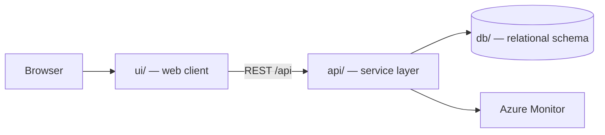

# Tutorial Safety Incident Reporting

Scope covers the mobile experience for anyone working on site: reporting an incident in under a minute, triage and notification by the safety lead, tracking corrective actions to verified completion, and closing the investigation into a record that supports statutory reporting. Occupational health case management, insurance claims, and payroll sit outside this release and are treated as downstream systems.

> Generated by the **Agentic SDLC / Software Factory**. Every change reaches this
> repository through an approved human gate — no agent merges its own work.

## Table of contents

1. [Overview](#overview)
2. [Architecture](#architecture)
3. [API surface](#api-surface)
4. [Screens](#screens)
5. [Folder structure](#folder-structure)
6. [Getting started](#getting-started)
7. [Build and test](#build-and-test)
8. [Deployment](#deployment)
9. [Published links](#published-links)
10. [Requirements scope](#requirements-scope)
11. [Intake documents](#intake-documents)
12. [Licence](#licence)

## Overview

| Item | Value |
| --- | --- |
| Project | Tutorial Safety Incident Reporting |
| Business owner | myaacoub@microsoft.com |
| IT owner | myaacoub@microsoft.com |
| Target environment | Dev |
| Work items | Tutorial Safety Incident Reporting |
| Source provider | GitHub |
| Repository | https://github.com/csdmichael/tutorial-safety-incident-reporting |

## Architecture

Three tiers, deployed independently from this single repository:



- **ui/** renders the experience and never talks to the database directly.
- **api/** owns validation, authorization, and all data access.
- **db/** holds the schema and forward-only migrations; no ad-hoc changes.

## API surface

The service publishes an OpenAPI document, so the contract is browsable rather than
described in prose. Swagger UI is at `/docs`; the raw document is at `/openapi.json`.
The published URLs appear under [Published links](#published-links) once the pipeline runs.

| Method | Path | Purpose |
| --- | --- | --- |
| `GET` | `/health` | Liveness probe used by the deploy pipeline |
| `GET` | `/api/reportings` | List reportings, optionally filtered by `?status=` |
| `POST` | `/api/reportings` | Create a reporting |
| `GET` | `/api/reportings/{id}` | Fetch one reporting |
| `PATCH` | `/api/reportings/{id}` | Update title, reference, status, priority |
| `DELETE` | `/api/reportings/{id}` | Remove a reporting |

`db/migrations/0002_seed.sql` loads placeholder rows, and the service seeds the same rows,
so a fresh environment returns data on the first request. Replace them with real data.

## Screens

Taken from the approved UX mockups:

- **Reportings**
- **Reporting Detail**

## Folder structure

```
.
├── ui/                  Web client
│   ├── src/             Application source
│   └── package.json     Scripts and dependencies
├── api/                 Service layer (Python (FastAPI))
│   ├── app/             Routers, models, services
│   ├── tests/           Unit and integration tests
│   └── requirements.txt Runtime dependencies
├── db/                  Database
│   ├── migrations/      Forward-only, numbered migrations
│   └── schema.sql       Current consolidated schema
├── docs/                Project documentation
│   ├── architecture.md  Tiers, data flow, decisions
│   ├── api-contracts.md Endpoint contracts
│   ├── data-model.md    Tables and relationships
│   └── delivery-plan.md Sprints and milestones
├── .github/workflows/   CI and Azure deployment pipelines
├── LICENSE              MIT
└── README.md            This file
```

## Getting started

```bash
# API
cd api && python -m venv .venv && .venv/bin/pip install -r requirements.txt
.venv/bin/uvicorn app.main:app --reload --port 8000

# UI
cd ui && npm install && npm start        # http://localhost:4200

# Database
psql "$DATABASE_URL" -f db/schema.sql
```

## Build and test

| Command | Purpose |
| --- | --- |
| `cd api && python -m pytest -q` | API unit tests |
| `cd ui && npm test` | UI unit tests |
| `.github/workflows/ci.yml and .github/workflows/deploy-azure.yml` | Runs both through GitHub Actions |

## Deployment

`.github/workflows/deploy-azure.yml` publishes the API and UI to Azure App
Service using **OIDC federated credentials** — no stored passwords. The Software
Factory configures the repository's Azure identity secrets and App Service variables
after validating the exact ID-qualified GitHub environment subject.

## Published links

<!-- agentic-sdlc:published-links:start -->
_Populated automatically once the deployment pipeline succeeds._
<!-- agentic-sdlc:published-links:end -->

## Requirements scope

- **Objective:** Implement the end-to-end Tutorial Safety Incident Reporting workflow (rapid incident capture → safety lead triage/notifications → corrective-action tracking → investigation closure) with the Angular + Ionic UI, FastAPI service layer, and PostgreSQL persistence, ensuring responsiveness, validation, and automated regression coverage as required in the intake requirements.[requirements]
- **Constraints & governance:**
- No hardcoded business/environment values: introduce tunables within the existing `config/` JSON files and load them at runtime in both UI and API layers.
- Sensitive data protection: enforce server-side validation, request/response filtering, and role-aware data exposure.
- Testing is mandatory for the main workflow, spanning unit, integration, and end-to-end paths.[requirements]
- **Repository state:** Unable to re-verify codebase or pipeline status because connector access is currently unavailable; plan assumes a clean repository aligned with the supplied requirements artifact.
- **Quick Incident Report Screen (Mobile-first default):**
- Minimal required fields (incident type, location, timestamp, narrative, optional attachments) grouped for sub‑1‑minute submission.
- Prominent progress/feedback toast states for success/failure.
- **Incident Detail & Triage Screen:**
- Tabs/segments for Summary, People Involved, Evidence, Notifications.
- Safety lead actions: classify severity, assign lead, record notification timestamps.

## Intake documents

- `requirements` — [tutorial-safety-incident-reporting-requirements.md](None)

## Licence

MIT — see [LICENSE](LICENSE).
